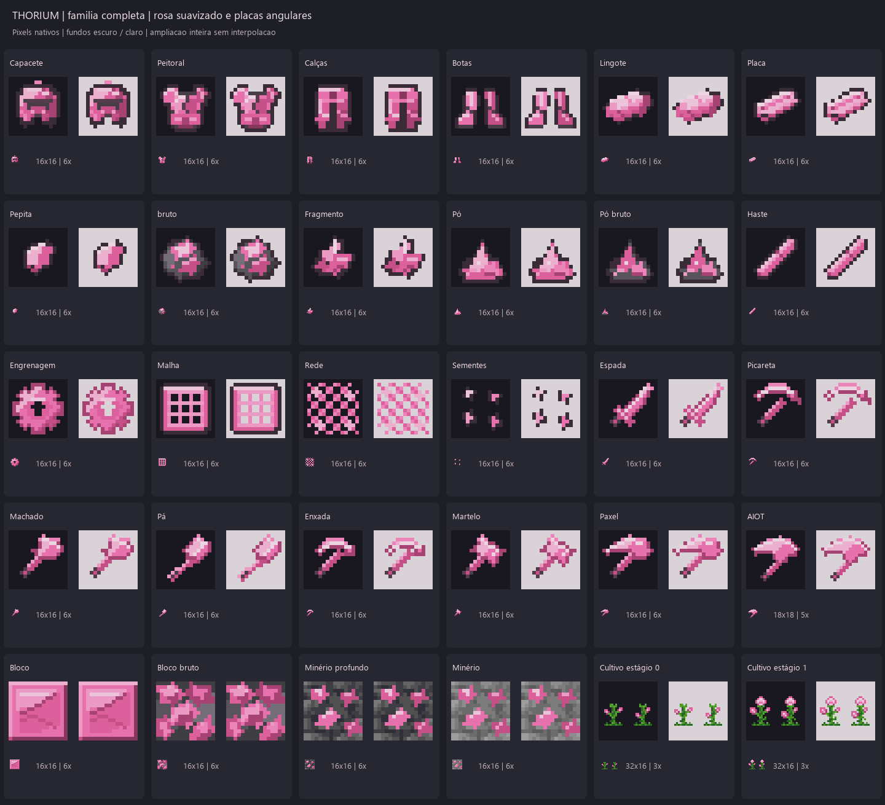

# Tório — família completa, revisão 2

O criador pediu a família completa e rejeitou a primeira armadura por parecer Titânio recolorido. Esta revisão constrói **30 texturas nativas**, com nova geometria de armadura, quinas e faces forjadas nos materiais e ferramentas, e rosa chiclete mais suave.



[Comparação com Titânio e Tório anterior](thorium_armor_comparison.png) · [Verificação executada](verification.json) · [Catálogo editável](catalog.json) · [Pasta unificada, somente PNGs](../../../../extras/generated_textures/)

## Conteúdo

Quatro ícones de armadura, oito ferramentas (espada, picareta, machado, pá, enxada, martelo, Paxel, AIOT), lingote, placa, pepita, bruto, fragmento, pó, pó bruto, haste, engrenagem, malha, rede, sementes, bloco metálico, bloco bruto, dois minérios e dois estágios de cultivo.

| Textura | Dimensão nativa | Cores visíveis | WARNING | Arquivos |
| --- | --- | ---: | ---: | --- |
| Capacete de Tório | 16×16 | 10 | 0 | [PNG](final/thorium_helmet.png) · [Revisão](final-review/thorium_helmet-evaluated.md) |
| Peitoral de Tório | 16×16 | 11 | 1 | [PNG](final/thorium_chestplate.png) · [Revisão](final-review/thorium_chestplate-evaluated.md) |
| Calças de Tório | 16×16 | 10 | 0 | [PNG](final/thorium_leggings.png) · [Revisão](final-review/thorium_leggings-evaluated.md) |
| Botas de Tório | 16×16 | 8 | 0 | [PNG](final/thorium_boots.png) · [Revisão](final-review/thorium_boots-evaluated.md) |
| Lingote de Tório | 16×16 | 8 | 0 | [PNG](final/thorium_ingot.png) · [Revisão](final-review/thorium_ingot-evaluated.md) |
| Placa de Tório | 16×16 | 7 | 1 | [PNG](final/thorium_plate.png) · [Revisão](final-review/thorium_plate-evaluated.md) |
| Pepita de Tório | 16×16 | 5 | 0 | [PNG](final/thorium_nugget.png) · [Revisão](final-review/thorium_nugget-evaluated.md) |
| Tório bruto | 16×16 | 9 | 1 | [PNG](final/raw_thorium.png) · [Revisão](final-review/raw_thorium-evaluated.md) |
| Fragmento de Tório | 16×16 | 7 | 0 | [PNG](final/thorium_chunk.png) · [Revisão](final-review/thorium_chunk-evaluated.md) |
| Pó de Tório | 16×16 | 7 | 0 | [PNG](final/thorium_dust.png) · [Revisão](final-review/thorium_dust-evaluated.md) |
| Pó de Tório bruto | 16×16 | 7 | 0 | [PNG](final/raw_thorium_dust.png) · [Revisão](final-review/raw_thorium_dust-evaluated.md) |
| Haste de Tório | 16×16 | 5 | 1 | [PNG](final/thorium_rod.png) · [Revisão](final-review/thorium_rod-evaluated.md) |
| Engrenagem de Tório | 16×16 | 6 | 1 | [PNG](final/thorium_gear.png) · [Revisão](final-review/thorium_gear-evaluated.md) |
| Malha de Tório | 16×16 | 5 | 0 | [PNG](final/thorium_mesh.png) · [Revisão](final-review/thorium_mesh-evaluated.md) |
| Rede de Tório | 16×16 | 3 | 2 | [PNG](final/thorium_net.png) · [Revisão](final-review/thorium_net-evaluated.md) |
| Sementes de Tório | 16×16 | 5 | 0 | [PNG](final/thorium_seeds.png) · [Revisão](final-review/thorium_seeds-evaluated.md) |
| Espada de Tório | 16×16 | 8 | 1 | [PNG](final/thorium_sword.png) · [Revisão](final-review/thorium_sword-evaluated.md) |
| Picareta de Tório | 16×16 | 8 | 1 | [PNG](final/thorium_pickaxe.png) · [Revisão](final-review/thorium_pickaxe-evaluated.md) |
| Machado de Tório | 16×16 | 9 | 1 | [PNG](final/thorium_axe.png) · [Revisão](final-review/thorium_axe-evaluated.md) |
| Pá de Tório | 16×16 | 9 | 1 | [PNG](final/thorium_shovel.png) · [Revisão](final-review/thorium_shovel-evaluated.md) |
| Enxada de Tório | 16×16 | 9 | 1 | [PNG](final/thorium_hoe.png) · [Revisão](final-review/thorium_hoe-evaluated.md) |
| Martelo de Tório | 16×16 | 9 | 1 | [PNG](final/thorium_hammer.png) · [Revisão](final-review/thorium_hammer-evaluated.md) |
| Paxel de Tório | 16×16 | 9 | 1 | [PNG](final/thorium_paxel.png) · [Revisão](final-review/thorium_paxel-evaluated.md) |
| AIOT de Tório | 18×18 | 9 | 1 | [PNG](final/thorium_aiot.png) · [Revisão](final-review/thorium_aiot-evaluated.md) |
| Bloco de Tório | 16×16 | 8 | 0 | [PNG](final/thorium_block.png) · [Revisão](final-review/thorium_block-evaluated.md) |
| Bloco de Tório bruto | 16×16 | 10 | 0 | [PNG](final/raw_thorium_block.png) · [Revisão](final-review/raw_thorium_block-evaluated.md) |
| Minério profundo de Tório | 16×16 | 10 | 0 | [PNG](final/deepslate_thorium_ore.png) · [Revisão](final-review/deepslate_thorium_ore-evaluated.md) |
| Minério de Tório | 16×16 | 10 | 0 | [PNG](final/thorium_ore.png) · [Revisão](final-review/thorium_ore-evaluated.md) |
| Cultivo de Tório estágio 0 | 32×16 | 7 | 1 | [PNG](final/thorium_0.png) · [Revisão](final-review/thorium_0-evaluated.md) |
| Cultivo de Tório estágio 1 | 32×16 | 10 | 1 | [PNG](final/thorium_1.png) · [Revisão](final-review/thorium_1-evaluated.md) |

São **23 ícones em 16×16**, um AIOT em 18×18, quatro faces de bloco em 16×16 e dois sprites de cultivo em 32×16 (layout existente de dois painéis 16×16). Nenhum foi criado em alta resolução para ser reduzido.

## Redesenho e paleta

- Capacete: viseira horizontal, ressalto baixo da testa, proteção de queixo e placas laterais próprias.
- Peitoral: gola rasa, ombreiras chanfradas, duas placas frontais, junção diagonal e lâminas de cintura.
- Calças: fecho na cintura, placas de coxa e joelheiras articuladas.
- Botas: caneleiras afiladas, recortes nos punhos e biqueiras de quinas cortadas.

A geometria dos quatro ícones difere de Titânio em 8, 14, 38 e 23 pixels de alfa, respectivamente. Essa é uma constatação de construção, não prova de qualidade artística; a comparação visual mostra as novas divisões internas.

A rampa anterior recebeu `S_novo = 0.8 × S_antigo` em HSV e `V_novo = 0.12 + 0.8 × V_antigo`. Após arredondamento para RGB de oito bits, a razão média de saturação é **0,8095** (cerca de 19% menor); a amplitude de luminosidade Oklab passou de **0,7187 para 0,5946** (cerca de 17% menor). Essas medidas descrevem a rampa do metal, sem fingir uma comparação de qualidade entre imagens diferentes. Forro, pedra e plantas usam materiais separados.

A barra e a placa são desenhos novos com três planos, pontas cortadas e marcas de forja. Hastes, peças e cabeças de ferramentas mantêm a mesma linguagem angular; os cabos são metálicos com pequenas faixas escuras. A primeira versão foi preservada em `previous/` e também como imagens `thorium_v1_*` na coletânea.

## Execução e correções reais

- Trinta planos executados por Pillow e pelo rasterizador da skill; dimensões/PNG/RGBA/alfa/paleta foram verificados.
- Primeira tentativa interrompida porque o capacete ainda não atendia ao contrato local de alteração da silhueta. Foi acrescentado um ressalto baixo e central da testa; o contrato foi mantido.
- Inspeção do bloco bruto detectou massas planas demais. Um refinamento com máscara mudou **68 pixels de metal, zero pixels de pedra**, adicionando faces de fratura. O PNG refinado é idêntico ao gerado pelo plano atualizado.
- Família final: **0 ERROR e 17 WARNING**, principalmente agrupamentos de uma cor/pixel e componentes desconectados em malhas/sementes. As coordenadas continuam nos relatórios; esses diagnósticos não foram silenciados.
- Reconstrução completa em diretório temporário: **30 PNGs idênticos por bytes**. O comando antigo de armadura também reproduziu os quatro novos ícones.
- Tentativa de reutilizar uma saída preenchida foi rejeitada sem alterar PNGs. As referências originais do AT mantêm seus hashes.
- Publicação em caminhos novos do RP; substituídos apenas os quatro ícones anteriores de Tório, com cópias preservadas. Pasta unificada: **92 arquivos, todos PNG**.

As observações visuais são específicas aos pixels e constam em `final-review/*-visual-evidence.json`. Ainda há decisões artísticas: escala e leitura das ferramentas combinadas, textura do bloco bruto, densidade das peças e preferência pela nova armadura. Os minérios usam um host profundo reconstruído da referência do AT; a variante clara tem rampa neutra autoral e não é apresentada como cópia exata da pedra vanilla.

## Reproduzir

Na raiz do AT, com Pillow e a skill instalada, escolha diretórios novos:

```powershell
python tools/generate-thorium-family.py --output work/thorium-family --report work/thorium-family-review
python tools/generate-thorium-icons.py --output work/thorium-armor --report work/thorium-armor-review
```

`generate-thorium-family.py --only` permite `armor`, `tools`, `materials`, `blocks` e `crops`. O comando antigo de ícones agora delega à mesma construção atual; não continua produzindo Titânio recolorido. A configuração da família é `catalog.json` e os desenhos em `designs/`.

Esta entrega coloca texturas no RP; não afirma testes de jogo nem funcionamento de novos itens/receitas. A aceitação artística humana permanece pendente.
