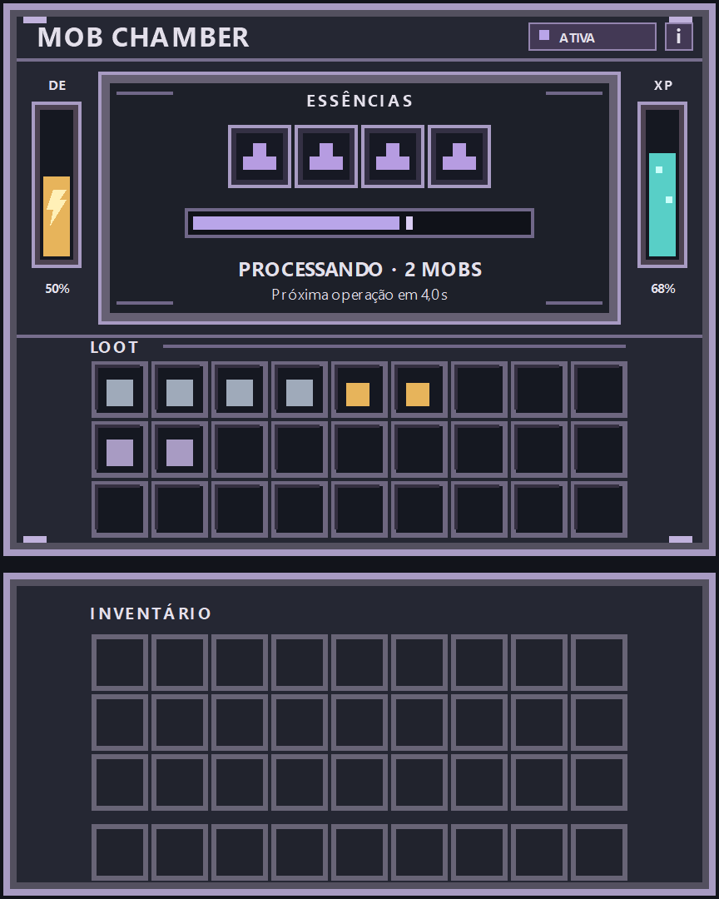

# Mob Chamber — proposta visual da interface

Status: implementado em `RP/ui/mob_chamber.json` e adaptado ao estilo vanilla a pedido do usuário. O conceito abaixo é referência de organização; sua paleta e moldura não representam mais a aparência aplicada. A interação e os logs ainda dependem de confirmação no Bedrock.

## Ideia central

A tela deve parecer um console acoplado ao multiblock de titânio: estrutura grafite, cantos e divisórias em titânio lilás, dois medidores laterais e uma câmara de processamento central. O olhar segue três etapas claras: essências → operação → resultados. O inventário do jogador mantém a apresentação nativa abaixo da máquina.

## Composição

Área da máquina de referência: 216 × 166 px lógicos. Os 27 resultados ocupam 162 × 54 px; a composição reserva 27 px de margem horizontal para essa grade. Todas as posições são relativas ao painel da máquina.

| Região | Posição aproximada | Apresentação |
| --- | --- | --- |
| Cabeçalho | y 4–18 | Nome à esquerda, indicador de estado compacto à direita. O botão nativo de fechar continua fora do conteúdo. |
| Câmara | x 29–187, y 23–94 | Rebaixo escuro com 1–8 essências centralizadas, uma linha de progresso abaixo e texto curto de estado. |
| Energia | x 9–25, y 30–79 | Medidor vertical âmbar, com ícone/abreviação de energia. |
| XP | x 191–207, y 30–79 | Medidor vertical ciano, visualmente paralelo ao de energia. |
| Saída | x 27–189, y 108–162 | 3 × 9 slots com alinhamento fixo. Uma pequena legenda “LOOT” separa a grade da câmara. |

Os slots de essência formam uma única linha centrada. A variante de um slot não fica encostada à esquerda; ao liberar outros, a linha cresce igualmente para os lados. Somente essa linha muda de largura. Medidores, progresso, estado, loot e inventário permanecem no mesmo lugar.

O progresso é uma faixa horizontal discreta, com o valor preenchido avançando da esquerda para a direita. Ela comunica o intervalo entre operações. Ao completar o ciclo, retorna ao início depois da operação; não sugere drenagem contínua de energia. O status fica logo abaixo e usa uma frase curta. Detalhes como custo, capacidade simultânea, intervalo e eficiência ficam no item de informações já existente, acessível por hover/foco.

## Linguagem visual

| Uso | Cor de referência | Origem/intenção |
| --- | --- | --- |
| Fundo da câmara | `#1D2029` | Grafite escuro, para destacar itens e indicadores. |
| Moldura e divisórias | `#53505F` | Titânio sombreado, inspirado na família de blocos atual. |
| Arestas iluminadas | `#A89BC3` | Lilás metálico da textura de titânio. |
| Energia | `#E7B45B` | Âmbar reservado ao medidor de DE. |
| XP líquido | `#58CFC7` | Ciano reservado ao tanque de XP. |
| Operação ativa | `#B9A5E9` | Pulso lilás sutil no progresso. |
| Alerta/bloqueio | `#DE786C` | Acento coral, sempre acompanhado de texto legível. |

Usar pixel art de bordas duras, sem gradientes suaves ou brilho sobre os itens. A moldura deve ser mais escura do que os próprios slots. A cor comunica prioridade, mas o estado também deve aparecer por escrito para não depender apenas da cor.

## Estados na tela

| Estado | Mensagem curta | Tratamento visual |
| --- | --- | --- |
| Sem essência | “Inserir essência” | Progresso vazio; câmara sem brilho. |
| Processando | “Processando” | Faixa lilás avança; sem animação intensa no restante do painel. |
| Energia insuficiente | “Energia insuficiente” | Medidor âmbar destacado; progresso preservado conforme a lógica da máquina. |
| Loot cheio | “Saída bloqueada” | Legenda LOOT em coral; grade permanece acessível para retirada. |
| XP cheio | “Tanque de XP cheio” | Medidor ciano com contorno coral; saída de itens permanece visível. |
| Estrutura inválida | Tela não operacional | Seguir o comportamento padrão de desmontagem/invalidação do multiblock. |

## Implementação

O fundo usa `textures/ui/panels/background_panel`, cinza e com relevo vanilla. Os slots usam diretamente `common.container_item`, com dimensões explícitas; o inventário usa os grids nativos. As linhas de essências são `collection_panel`, permitindo que os filhos recebam `collection_index` corretamente. As barras de energia e XP usam `uc.bar` sem alterações, renderizando os itens reais dos slots 0 e 8 com suas molduras padrão. O progresso horizontal permanece branco. Os trilhos mantêm o recorte branco de `textures/ui/white`. O inventário do jogador ocupa um painel separado de 216 × 92 px, começando em y 170; o conjunto mede 216 × 262 px. Há um único botão nativo de fechar no canto direito do cabeçalho. O UC Core não é modificado.

O slot 2 mantém o item `utilitycraft:progress_right_big_bar_NN`; seu nome recebe o marcador de apresentação `at:mob_chamber:meters:v1|tN|eN|xN|sSTATE|`. O progresso usa 23 estados (0–22). Os campos de energia e XP do marcador são mantidos por compatibilidade; as barras agora mostram diretamente os itens produzidos por `EnergyStorage.display` e `FluidStorage.display`. Isso não muda consumo, capacidade, duração ou transações. Os itens existentes de energia, XP e informações continuam fornecendo os valores exatos e detalhes por hover/foco; o marcador do timer não é exposto como tooltip.

Os textos do console estão em inglês e português. Os estados de bloqueio recebem texto vermelho; loot e XP também têm destaque na região correspondente. As prévias com dados simulados estão em `docs/previews/mob-chamber/`; o conceito original permanece intacto. Para reproduzir: `node tools/preview-ui-review.cjs --machine=mob_chamber --out=docs/previews/mob-chamber --locale=pt_BR`. O renderizador usa fonte aproximada e simula os leitores de coleção; não substitui o teste no jogo.

O título continua selecionando o wrapper do Mob Chamber. O item placeholder continua selecionando a variante de 1–8 essências por meio do marcador `at:mob_chamber:v1|eN|pNN`. A composição visual não troca botões nem os índices antigos de slot: os novos slots ficam em 36–39. Validar a proposta no jogo em GUI scale pequeno e grande, mouse, toque e controle antes de considerar as medidas finais.

### Correção dos avisos reportados

O log fornecido repetia variáveis ausentes (`$panel_size`, `$renderer_size`, `$renderer_offset`) nos controles herdados e `collection_index` desconhecido nas essências. A tela passou a usar propriedades nativas explícitas para o renderer e pais de coleção nas linhas de essências. A correção está restrita ao Mob Chamber; AT Core e UC Core não foram alterados. O aviso de categoria de `utilitycraft:control_panel` pertence ao catálogo do UtilityCraft e não faz parte dos erros desta UI.

### Display lateral

O painel `at_common.info_panel` fica à esquerda, mede 104 × 262 px e recebe texto do slot 1 por `at_core.collection_text`, com 8 px de padding e escala 0,55. Exibe status, essências, paralelismo, intervalo, eficiência, custo da operação e quantidades/capacidades de energia e XP. O conjunto é centralizado com offset horizontal de 52 px no painel principal. O botão de informação foi removido, pois esses dados ficam permanentemente visíveis.
